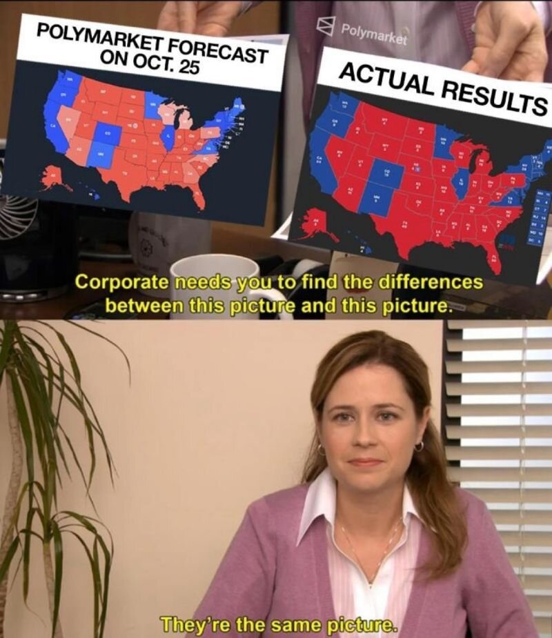

With the midterm election results coming in tomorrow, I got into predictive modelling. People like Nate Silver put a percentage on each candidate's chance of winning, built from polls, surveys, historical data and past win rates. I am just a gravitational wave data analyst, but I do work with time series and forecasting every day, so it made me wonder whether I, or really anyone who knows some probability, could do the same.

## A bazillion ads

That rabbit hole led me to prediction markets, specifically Kalshi and Polymarket, mostly because of the bazillion Kalshi ads I kept getting on YouTube. There are plenty of memes about the ridiculous things people bet on there, like whether the US government will confirm that aliens exist, or whether [Jesus Christ will return before GTA VI](https://relevantmagazine.com/culture/people-are-betting-real-money-that-jesus-will-return-before-gta-vi/) comes out, both on Polymarket, the platform founded by Shayne Coplan. Kalshi, co-founded by Tarek Mansour, has its own endless list, and both have an entire section for the midterms.

What I am actually interested in is whether these platforms should exist at all. Billions of dollars are being traded on them, billions of dollars are being made, and [Google Finance now shows their odds](https://decrypt.co/347619/google-finance-integrates-polymarket-kalshi-prediction-market-data) right next to stock prices.

## Why now?

I kept coming back to three questions. Why do these markets exist now and not twenty years ago? Why are they allowed to operate with so little transparency about who is betting and how much, when we already struggle with that in places like hedge funds? And most of all, how is any of this legal?

The idea itself is not new. In 1988, faculty at the University of Iowa set up the [Iowa Electronic Markets](https://en.wikipedia.org/wiki/Iowa_Electronic_Markets), small real-money markets to study how people predict presidential elections. Of course the odds depend on who is betting, how much money they have and how many of them there are. But when researchers compared the market with 964 polls across five presidential elections, the market was [closer to the final result 74% of the time](https://www.researchgate.net/publication/222541752_Prediction_Market_Accuracy_in_the_Long_Run). Polymarket made a similar point in 2024, when it [strongly favoured Donald Trump](https://www.forbes.com/sites/dereksaul/2024/10/24/who-is-polymarkets-trump-whale-site-reveals-french-trader-bet-28-million-on-trump-win/) while most poll-based models called the race a toss-up.

<figure class="nc-meme"><figcaption>How the internet saw Polymarket&#39;s 2024 forecast. Image via <a href="https://smartcontract.tips/en/post/polymarket-better-than-analysts-us-elections">smartcontract.tips</a>.</figcaption></figure>

The catch is that Iowa was only allowed to run because the Commodity Futures Trading Commission (CFTC), the federal regulator for futures markets, agreed not to step in as long as the markets were used for [academic research, run not-for-profit and capped at $500 per person](https://www.cftc.gov/sites/default/files/idc/groups/public/@lrlettergeneral/documents/letter/14-130.pdf). So what changed? Mostly the courts. Kalshi sued the CFTC, and in September 2024 a federal judge ruled that Kalshi could list contracts on US elections. When the CFTC [dropped its appeal in May 2025](https://www.coindesk.com/policy/2025/05/06/cftc-drops-appeal-in-kalshi-election-betting-case), the floodgates opened.

## Not gambling, apparently

Let's be honest about what these are. Launching a gambling business in the US means getting a licence in every state you operate in, which is slow and expensive, and that is exactly why sports betting companies spend so much on lawyers. Prediction markets found a shortcut by calling themselves something else. Their bets are structured as event contracts, a kind of financial derivative in the same family as futures and options, which means they answer to the CFTC instead of state gambling regulators. Tarek Mansour has [argued](https://www.cato.org/multimedia/economics-it/economics-kalshi) that every new financial product gets called gambling at first, going all the way back to grain futures in the 1800s, and told Axios that "if we are gambling, then I think you're basically calling the entire financial market gambling."

But then how is "Will Jesus return before GTA VI" a financial derivative? This is regulatory drift. You start somewhere legal that follows the rules and makes sense, and then, one market at a time, you drift. And for platforms that insist they are completely different from sportsbooks, about [89% of Kalshi's 2025 fee revenue came from sports](https://www.ingame.com/kalshi-fee-revenue-2025/), rising above 90% by the end of the year. The courts can't agree on it either. Appeals courts have [split on whether states can regulate Kalshi's sports contracts](https://www.cnbc.com/2026/09/25/appeals-court-rules-states-can-regulate-sports-prediction-markets.html) as gambling, and the question may end up at the Supreme Court.

## A lopsided game

Betting can be fun, and I think adults should be allowed to do it. My problem is with how lopsided these markets are. In a [New York Times op-ed](https://www.nytimes.com/2026/01/23/opinion/prediction-markets-reality-democracy.html), Kyla Scanlon argued that big traders have outsized influence and could be profiting from insider information, and ahead of the midterms Polymarket itself reportedly investigated [dozens of trades](https://variety.com/2026/digital/news/midterm-elections-odds-prediction-spending-house-and-senate-1236938339/) for insider trading and manipulation. The more money or information you have, the more the market bends towards you. In 2024, a single French trader known as Théo bet tens of millions of dollars on Trump and [walked away with an estimated $85 million](https://finance.yahoo.com/news/polymarket-whale-actually-made-85-050139914.html).

That becomes dangerous once people start treating the odds as truth. A powerful person could quietly put money behind an outcome to test the waters, or to make it look more likely than it is, and the market would report it as consensus. It does not help that the news is now part of the loop. CNN has had a [data partnership with Kalshi](https://www.axios.com/2025/12/02/cnn-kalshi-prediction-market-data) since December 2025, and ahead of the midterms CBS, CNBC and Dow Jones all [signed deals](https://www.thewrap.com/media-platforms/journalism/polymarket-kalshi-cnn-cnbc-dow-jones/) with Kalshi or Polymarket.

And then there is the moral side, which bothers me the most. When the US and Israel struck Iran this year, Reuters found hundreds of millions of dollars riding on [contracts about the timing of the attacks and on Ayatollah Khamenei's removal](https://www.cbc.ca/news/business/prediction-market-bets-iran-strikes-insider-trading-allegations-9.7112463), and Polymarket paid out to the people who bet he would be gone. Critics started calling these [death markets](https://edition.cnn.com/2026/03/07/politics/iran-war-prediction-markets-polymarket-kalshi), and Polymarket only pulled a bet on whether a nuclear weapon would be detonated [after a huge backlash](https://www.theblock.co/post/392161/polymarket-removes-nuclear-detonation-market). When a war becomes something you can win or lose money on, people's attention shifts from the people dying to their own profit and loss. It reminds me of the crowds at the Colosseum, paying to watch fatal fights. That kind of desensitisation is a moral disaster waiting to happen.

## So am I betting?

Whatever these markets are, with the rules this up in the air, and with me being far more informed about JWST observing cycles than about world politics, I am not taking part right now. Betting with half the knowledge is how you end up on the wrong side of the people who have all of it. Regardless, the markets are giving Democrats a [78% chance of taking the Senate and 95% for the House](https://variety.com/2026/digital/news/midterm-elections-odds-prediction-spending-house-and-senate-1236938339/), so they are calling a blue wave tomorrow, and I cannot wait to see if they are right.
